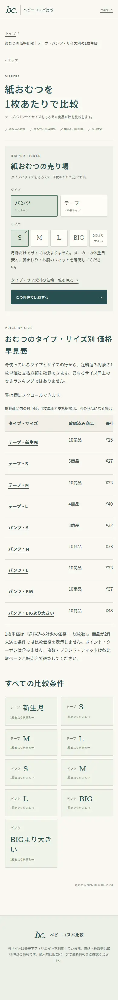
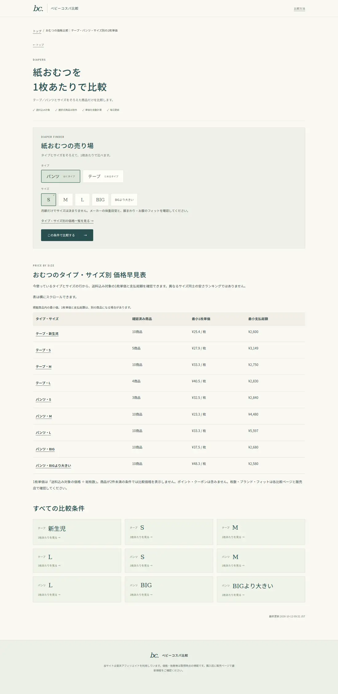

# 第1弾の検証

- Python 64件、JavaScript 7件が成功。
- 320/390/1440pxの変更後プレビューにdocument幅のはみ出し、JavaScript例外なし。
- モバイルでは比較表の横スクロール操作成功。表の行名を固定して条件を見失わない。
- HTML/商品/判定の入力元は既存コード。ベビーの表は公開済みlatest.json（2026-10-12 09:32 JST）からのプレビュー。きょうボドは公開済みrakuten.jsonの72件を一時的なローカルキャッシュに使用。キャッシュや架空商品はコミットしない。
- 商品判定、送料判定、楽天URL、数量、カタログ、診断ロジックを変更していない。
- Python試験のベビーデータはfixtureで、公開商品数や収益の証拠ではない。
- スクリーンショットは変更後のローカル生成HTMLを本番と同じURL構造で表示。公開済みとの主張ではない。
- ブラウザのGA4通信は遮断。購入リンクはクリックしていない。
- 公開5サイトは3幅で確認成功。基準の日用品トップは390/1440pxで取得タイムアウト（HTTP監査と320pxは成功）。実サイト障害と断定しない。
- ラボの通信時間にはプロキシ影響がありCore Web Vitals合格は未確認。

## レビュー画像

## 公開後の評価

人間の承認後に実公開日を記録し、7日/28日で検索表示・クリックと対象ページの利用を評価。表示300回未達。効果未測定で他サイトへ一括展開しない。
